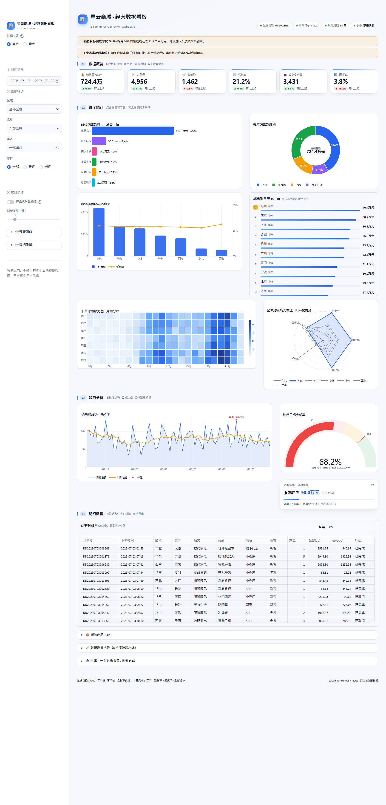
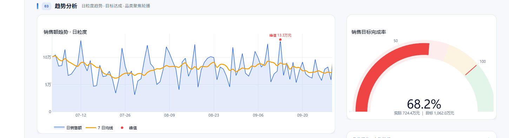
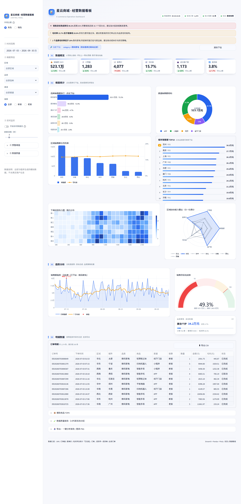
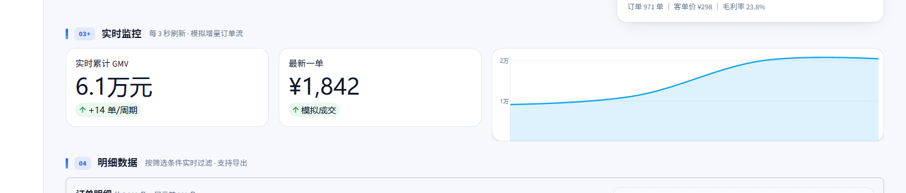
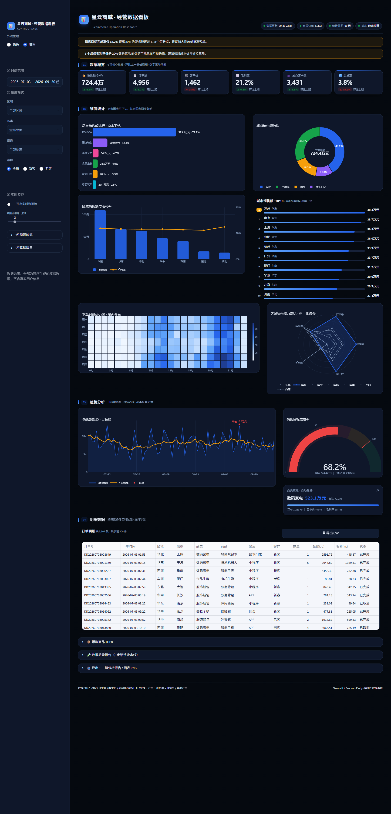
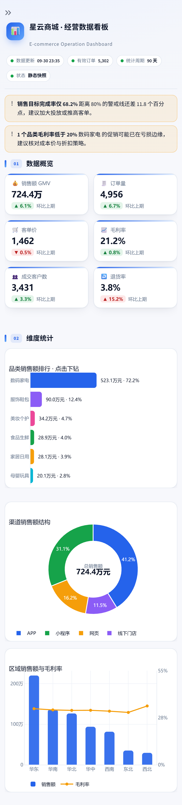

# 用 Streamlit + Plotly 做一个"能落地"的经营数据看板：从造数据到实时监控

> 实验 2《数据看板的设计与实现》完整复盘。
> 代码共 9 个模块、约 1600 行，覆盖基础任务 5 项、进阶任务 3 项、扩展任务 5 项。
> 完整工程见同目录 `ecom-dashboard/`。

---

## 0. 先看结果

一个电商经营看板，暗色主题、四大分区、点击可下钻：



技术上它并不复杂——`Streamlit + Pandas + Plotly` 三个库就够。真正花时间的不是"把图画出来"，而是下面这三件事：

1. **数据要像真的**：有趋势、有周期、有大促脉冲，还得有脏数据让你洗；
2. **版面要有层级**：同一批图，排得乱就是"图表堆砌"，排得对才是"看板"；
3. **交互要有意义**：筛选、联动、下钻不是炫技，是为了回答"然后呢？"。

这篇文章按真实开发顺序讲：需求拆解 → 技术选型 → 造数据 → 洗数据 → 指标口径 → 版面与图表 → 交互 → 踩坑。踩坑部分是全文最有价值的部分，我把每个问题的**症状、原因、修法**都写清楚了。

---

## 1. 需求拆解：先把"看板"翻译成"页面"

实验任务书给了四大分区，但没告诉你每块放什么。我的拆法是**按"读者的问题"分区**，而不是按"图表类型"分区：

| 分区 | 回答的问题 | 放什么 |
|---|---|---|
| ① 数据概览 | 现在整体怎么样？比上期好还是差？ | 6 张核心指标卡（含环比）+ 目标完成率 |
| ② 维度统计 | 钱是哪些品类/渠道/区域贡献的？ | 品类排行、渠道环形、区域柱线、城市 TOP10、时段热力、能力雷达 |
| ③ 趋势分析 | 走势如何？有没有异常点？达标了吗？ | 日趋势折线（含 7 日均线、峰值标注）、目标仪表盘、品类轮播 |
| ④ 明细数据 | 具体是哪几笔？能导出去吗？ | 可筛选明细表 + CSV/报告导出 |

一条隐含的设计约束：**一屏之内必须能回答"整体好不好"，所以指标卡（①）永远在最上面**。往下才是"为什么"（②③）和"具体是什么"（④）。这就是视觉层级，不是审美偏好。

业务场景选了"电商销售"——它有天然的多维结构（时间/地域/品类/渠道/客群），指标之间也有内在矛盾（要 GMV 还是要毛利），适合做分析型看板。

---

## 2. 技术选型：为什么是 Streamlit 而不是 ECharts

做数据看板有三条常见路线，我对比后选了第一条：

| 方案 | 优势 | 代价 | 适合 |
|---|---|---|---|
| **Streamlit + Plotly** | 纯 Python，一个文件就能跑；`st.fragment` 做局部刷新；图表交互开箱即用 | 深度定制样式要写 CSS；前端能力弱 | 课程实验、内部工具、快速验证 |
| ECharts + 前端框架 | 视觉上限最高，大屏特效自由 | 要写 JS/Vue，数据接口另做 | 对外交付的大屏 |
| Superset / Metabase | 零代码 | 定制性差，指标口径难统一 | 已有数仓的团队 |

关键在于：这个实验的核心是**数据思维与可视化设计**，不是前端工程。Streamlit 把"渲染"这件脏活吃掉了，我可以把 90% 的精力放在数据与设计上。

代价也很清楚——Streamlit 默认长相很"毛坯"。所以我花了大约 250 行 CSS（`src/theme.py`）把它"装修"成成品：卡片化面板、双主题变量、渐入动画、响应式断点。这部分后面单独讲。

---

## 3. 架构：让每个文件只干一件事

```
ecom-dashboard/
├── app.py              页面编排与交互（唯一"读"的文件）
├── config.py           配色 / 主题 token / 阈值 / 指标元信息
├── scripts/
│   ├── generate_data.py    造数据（含 6 类脏数据）
│   └── prepare_data.py     离线清洗 → csv / xlsx / quality_report.json
├── data/
├── src/
│   ├── preprocess.py   8 步清洗流水线 + 特征衍生
│   ├── loader.py       st.cache_data 缓存
│   ├── metrics.py      指标口径（唯一计算入口）
│   ├── charts.py       图表工厂（一类图一个函数）
│   ├── components.py   自研 HTML 组件
│   ├── theme.py        双主题 CSS
│   ├── alerts.py       阈值预警引擎
│   ├── report.py       报告 / CSV / 图片导出
│   └── format.py       金额、百分比、环比格式化
└── .streamlit/config.toml
```

一条铁律：**依赖只能向下**。`charts.py` 不 import `app.py`，`metrics.py` 不 import `streamlit`。好处很实际：

- 换配色 → 只改 `config.py` 两个字典；
- 改口径（比如"退货率要不要含取消单"）→ 只改 `metrics.py` 一处，卡片、图表、报告全同步；
- 想单独跑数据验证 → `python -c "from src.metrics import ..."`，不依赖页面。

一个反面例子是我最初把 `groupby` 写在了 `app.py` 里，结果"区域毛利率"在图表和报告里算出来差 0.3 个百分点——因为一个用了均值、一个用了加权。这类 bug 在仪表盘里最致命，因为它不报错，只是"数字看起来不太对"。

---

## 4. 造数据：让曲线"像真的"

真实的业务数据有四种痕迹，缺一个就会"假"：

```python
# ① 趋势：月均增长 2.5%
w *= 1.0 + 0.025 * (i / 30.0)
# ② 周内周期：周末是工作日的 1.25 倍
w *= 1.25 if d.weekday() >= 5 else 1.0
# ③ 大促脉冲：618 是 2.8 倍，前后还有蓄水与回落
w *= CAMPAIGN_DAYS.get(d.strftime("%Y-%m-%d"), 1.0)
if -3 <= gap <= -1: w *= 1.25      # 大促前 3 天蓄水
elif 1 <= gap <= 2: w *= 0.7       # 大促后 2 天回落
# ④ 时段分布：10-12 点、20-22 点双高峰
hour = rng.choices(range(24), weights=HOUR_WEIGHTS)[0]
```

价格不能用均匀分布——真实成交是"低价商品多、高价商品少"，所以用**对数均匀分布**取价：

```python
unit_price = float(np.exp(rng_np.uniform(np.log(lo), np.log(hi))))
```

这样画出来的价格分布是右偏的，条形图和箱线图才不会失真。

### 故意弄脏

没有脏数据，清洗模块就没有存在意义。我注入了 6 类问题：

| 问题 | 比例 | 埋的坑 |
|---|---|---|
| `city` / `payment` 缺失 | 1.8% / 0.8% | 维度归属丢失 |
| `quantity` 为负 | 0.6% | 符号录错 |
| `amount` 放大 60 倍 | 0.4% | 单位错误（元/分） |
| 时间写成 `2026-13-45` | 0.4% | 无法解析 |
| `product` 为空串 | 0.4% | 类目分析丢样本 |
| 整行重复 | 1.2% | 埋点重复上报 |

最终生成 15,180 行原始数据。

---

## 5. 洗数据：一条"可审计"的流水线

清洗最怕"悄悄删了几万行，没人知道"。所以我的 `clean_orders()` 返回的是 `(干净数据, 质量报告)`，每一步都记下**影响行数**：

```python
def log(step, action, affected, note=""):
    report["steps"].append({"step": step, "action": action,
                            "affected": affected, "note": note})
```

八个步骤：

| 步骤 | 动作 | 本例影响 |
|---|---|---|
| S1 | 字段规范化（列名去空格、补缺失列） | — |
| S2 | 时间解析，非法时间剔除 | 61 行 |
| S3 | 主键去重（按 `order_id` 保留首单） | 179 行 |
| S4 | 数值列 `to_numeric` | — |
| S5 | 分类填「未知」、数值填中位数；无法归属维度的记录剔除 | 449 行 |
| S6 | 负销量取绝对值；金额与「单价×数量×折扣」不一致则重算 | 90 + 59 行 |
| S7 | 分品类 IQR 上界**缩尾** | 1,034 行 |
| S8 | 特征衍生（11 个字段） | — |

15,180 → 14,940 行，留存 98.42%。

这里有两个值得说的决策：

**① 异常值用"缩尾"而不是"删除"。**
金额的极值往往是真实大单（企业采购、批采），直接删会低估 GMV。所以按品类算 IQR 上界，超出的**截断到上界**而不是丢弃——保留订单，修正量级。

**② 异常判断要分品类做。**
全局 IQR 会把数码家电的正常高价单判成异常。按品类分组算，各品类的价格带才不会被互相污染：

```python
for _, idx in df.groupby("category").groups.items():
    q1, q3 = df.loc[idx, "amount"].quantile([0.25, 0.75])
    upper = q3 + 1.5 * (q3 - q1)
    ...
```

清洗结果落三份文件：`orders_clean.csv`（明细）、`orders.xlsx`（明细 + 数据质量 + 品类汇总三个 Sheet）、`quality_report.json`（日志）。看板侧边栏的「⑤ 数据质量」直接读这份日志——**让数据可信，比让图表好看更重要**。

---

## 6. 指标口径：先定义，再画图

看板里最容易吵架的不是配色，是"这个数怎么算的"。所以我把口径写进了代码注释和页脚：

- **销售额 / 订单量 / 客单价 / 毛利率 / 客户数**：只统计「已完成」订单；
- **退货率** = 退货订单 ÷ 全部订单（不是 ÷ 完成订单）；
- **环比** = 与「等长的上一周期」对比（选 90 天，就对比前 90 天）。

`kpi_snapshot()` 一次算出 6 个指标，卡片、报告、明细全部复用同一份结果：

```python
def kpi_snapshot(df):
    done = df[df["is_completed"]]
    total_orders = df["order_id"].nunique()
    gmv = float(done["amount"].sum())
    orders = float(done["order_id"].nunique())
    return {
        "gmv": gmv,
        "orders": orders,
        "aov": gmv / orders if orders else 0,
        "gross_margin": float(done["profit"].sum()) / gmv * 100 if gmv else 0,
        "customers": float(done["customer_id"].nunique()),
        "return_rate": float(df["is_returned"].sum()) / total_orders * 100,
    }
```

还有一个细节：**环比方向 ≠ 好坏方向**。销售额涨 6% 是好事，退货率涨 15% 是坏事。所以指标元信息里带一个 `better` 字段，卡片据此决定标绿还是标红：

```python
"return_rate": {"label": "退货率", "better": "down", ...}
```

---

## 7. 版面：把"毛坯房"装修成看板

Streamlit 默认的页面是留白 + 无边框元素，直接堆图表会显得松散。我做四件事：

**① 统一容器。** 每张图都是一个卡片：白底、1px 描边、16px 圆角、极浅投影。用 CSS 直接接管 Streamlit 的图表容器：

```css
[data-testid="stPlotlyChart"]{
  background: var(--panel);
  border: 1px solid var(--border);
  border-radius: 16px;
  box-shadow: var(--shadow);
  padding: 4px 8px 2px;
}
```

**② 一切颜色走变量。** 亮/暗两套 token 在 `config.py`，Python 侧传给图表，CSS 侧传给 DOM。切换主题时只换一组值：

```python
THEMES = {
  "light": {"bg": "#F4F6FB", "panel": "#FFFFFF", "text": "#0F172A", ...},
  "dark":  {"bg": "#070C16", "panel": "#0F172A", "text": "#E6EDF7", ...},
}
```

**③ 栅格比例不平均分。** 主图给 1.95 : 1，副图给 1.28 : 1。信息密度高的图占更多宽度，读者的视线自然会沿着"大图 → 小图"走。

**④ 断点。** `max-width: 1180px` 收窄内边距与字号，`max-width: 900px` 隐藏说明文字、图表满宽。指标卡的 iframe 高度也跟着 6 列 → 3 列 → 2 列变化（这个坑后面单独讲）。

---

## 8. 图表选型：为什么是这张图

选图不是"我会画什么"，而是"这组数据适合什么"。六个决策：

| 数据特征 | 选的图 | 理由 |
|---|---|---|
| 分类对比 + 类目名较长 | **横向条形图** | 中文类目竖排会挤在一起；横向还能直接标数值和占比 |
| 构成占比（4 类） | **环形图** | 比饼图中间能塞总量，信息密度更高；比堆叠柱更易读 |
| 时间序列（90 天日粒度） | **折线 + 面积 + 7 日均线** | 日粒度噪声大，均线才能看清趋势；面积强化"量"的感觉 |
| 两维交叉（星期×小时） | **热力图** | 24×7 有 168 个格子，只有色阶能一屏看完 |
| 多指标能力对比（5 维×7 区域） | **雷达图** | 单区域形状一眼看出"偏科"，但必须归一化，否则量纲打架 |
| 单值 vs 目标 | **仪表盘** | 只适合"完成率"这种有明确区间的指标 |

### 几个具体处理

**折线要标峰值。** 只画曲线，读者还要自己找最高点。加一个红点 + 标注：



**热力图不是越花越好。** 用单色相渐变（浅蓝→深蓝）而不是彩虹色阶——彩虹色阶会让人误以为不同颜色代表不同类别。周一至周日固定顺序（`reindex`），避免 Pandas 按字母排序把"周五"排到"周一"前面。

**雷达图必须归一化。** 销售额是百万级、毛利率是百分比，不归一化就只剩一根轴。做法是 min-max 到 0-100：

```python
norm = (raw - raw.min()) / (raw.max() - raw.min()).replace(0, np.nan)
```

而且只填充高亮区域，其余区域只画线——否则七层颜色叠上去就是一团糊。

**排行榜用 HTML 而不是图表。** 城市 TOP10 如果用条形图，占的纵向空间和品类图一样多，但信息量只有一半。改用"名次 + 名称 + 进度条 + 数值"的 HTML 列表，同样高度能放 10 行，还带进度动画。

---

## 9. 交互：筛选、联动、下钻

### 9.1 交叉过滤：点图为什么不会"塌成一根柱"

这是我在做联动时踩的第一个设计坑。最初所有图表都用过滤后的 `df_view` 重算，结果点击「数码家电」后，品类榜只剩一根柱——**对比的基准没了**。

正确做法是 BI 工具里的「highlight 与 filter 分离」：**一张图不被"自己这一维"的下钻过滤**。

```python
def cross(dim: str) -> pd.DataFrame:
    if drill and drill["dim"] != dim:
        return df[df[drill["dim"]] == drill["val"]]
    return df
```

于是点「数码家电」时：品类榜保留 6 个品类并高亮选中项（其余淡化），而渠道环形、区域柱线、趋势、热力、明细全部切到该品类。



注意看这张图：品类榜还是 6 根柱（数码家电实心、其余半透明），渠道环形图变成"数码家电内部的渠道结构"，GMV 从 724.4 万变成 523.1 万，目标完成率从 68.2% 掉到 49.3%。这才叫联动。

点击事件的接法（Streamlit ≥1.35 的 `on_select`）：

```python
ev = st.plotly_chart(fig, key="cat_bar", on_select="rerun", selection_mode="points")
val = ev["selection"]["points"][0].get("y")     # 条形图的 y 就是类目名
```

### 9.2 "清除下钻"为什么清不掉

这是第二个坑，很隐蔽。点完图之后，Plotly 的选中状态是**持久**的：点「清除下钻」把 `drill` 置空，下一轮 rerun 时图表仍然返回同一个选中点，于是又把你拉回下钻状态——按十次也清不掉。

解法是记一个"忽略签名"：

```python
def _apply_drill(dim, val):
    sig = f"{dim}:{val}"
    SS["last_sig"] = sig
    if sig == SS["ignore_sig"]:      # 这个选中点刚刚被清除过，跳过
        return
    if SS["drill"] != {"dim": dim, "val": val}:
        SS["drill"] = {"dim": dim, "val": val}
        st.rerun()
```

清除时把当前签名写进 `ignore_sig`。等用户点了另一个点，签名变了，下钻自然恢复。这类"状态机"问题不会报错，只会让人抓狂。

### 9.3 自动轮播：不要为了一个卡片重跑整页

品类轮播每 6 秒切一次。如果用 `time.sleep` + `st.rerun()`，整页（含 8 张图和 1.3 万行数据处理）每 6 秒重建一次，滚动位置会跳、体验很差。

`st.fragment(run_every=...)` 只重跑这个片段：

```python
@st.fragment(run_every="6s")
def _inner():
    idx = SS.get("carousel_idx", 0) % len(top)
    ...  # 只渲染这一张卡
```

### 9.4 实时模式：模拟一条数据流

打开「实时数据流」，每 N 秒模拟一批增量订单，滚动展示最近 40 个周期的 GMV：

```python
tick = gmv_per_sec * interval * random.uniform(0.55, 1.65)   # 带波动的增量
```

真实项目里把「模拟的随机订单」换成接口/数据库查询即可，其余代码不用动——这也是我把 `render_live()` 独立成函数的原因。



### 9.5 主题切换：别让用户点两次

最初我用 `st.radio` 直接赋值：

```python
SS["theme_mode"] = st.radio("外观主题", ["亮色", "暗色"])
```

症状：点「暗色」，单选框变了，但页面还是亮的；要再点一下别的地方才生效。

原因很朴素——CSS 是在脚本**顶部**注入的，而 radio 的值在**底部**才更新。一次 rerun 里"读的是旧值"。改用 `on_change` 回调，它在整页重跑**之前**执行，于是顶部的读取就是新值：

```python
def _sync_theme():
    SS["theme_mode"] = SS["theme_radio"]

st.radio(..., key="theme_radio", on_change=_sync_theme)
```

暗色效果：



### 9.6 移动端

`initial_sidebar_state="auto"` 让侧边栏在手机上自动收起；指标卡 iframe 高度按断点从 116px 调到 232px、348px；图表满宽。430px 宽度下依然可读：



---

## 10. 踩坑记（这部分最值钱）

### 坑 1：Plotly 标题被"吃掉"了一半

**症状**：图表标题只显示下半截，被卡片的顶边裁掉。
**原因**：`title` 的 `y` 默认走 `container` 坐标系，某些版本里 `y=1, yanchor="bottom"` 会把标题顶到画布外。
**修法**：显式指定参考系为上边距：

```python
title=dict(text=..., x=0.012, xanchor="left",
           y=1.0, yref="paper", yanchor="bottom")
```

### 坑 2：图例把标题盖住了

**症状**：环形图右上角"渠道销售额结构"和"APP / 小程序 / 网页"叠在一起。
**原因**：标题默认在绘图区上方，横排图例也放上方，两者抢同一块空间。
**修法**：图例统一放**底部**（`y=-0.14, yanchor="top"`），并把下边距调到 54px。标题留在左上，各占一片。

### 坑 3：全局字体把 Material 图标变成了文字

**症状**：侧边栏折叠面板上出现 `_arrow_④预警阈值` 这种鬼东西。
**原因**：我写了 `[data-testid="stSidebar"] * { font-family: ... }`，把图标字体的 `font-family` 也覆盖了，于是 ligature 文本 `keyboard_arrow_right` 被当成普通文字渲染出来。
**修法**：去掉通配选择器，并给图标加保护规则：

```css
[data-testid="stIconMaterial"], .material-symbols-rounded{
  font-family:"Material Symbols Rounded","Material Icons",sans-serif !important;
}
```

### 坑 4：右轴刻度全没了

**症状**：双轴图（柱=销售额、线=毛利率）右轴只剩一个 `0%`。
**原因**：`fig.update_yaxes(tickvals=...)` **不带 selector 时会作用到所有 y 轴**，我为了让左轴显示"万"而设的刻度值（0/50万/100万）被同时写进了右轴，而右轴范围只有 0~38，于是只有 0 落在范围内。
**修法**：给右轴单独校准一次刻度。

```python
yaxis_wan(fig, gmv_max)                       # 左轴：200万 / 100万 / 0
fig.update_layout(yaxis2=dict(tickvals=[0, top/2, top],
                              ticktext=[f"{t:.0f}%" for t in ticks]))
```

### 坑 5：指标卡在手机上被切成半截

**症状**：手机上 6 张卡要换 3 行，但只显示 2 行半，第三行被下一节标题盖住。
**原因**：卡片跑在 `st.components.v1.html` 的 iframe 里，高度是 Python 传的固定值（132px）。iframe 内部按 CSS 换行了，外部容器还停在 132px，于是内容溢出、被后面的元素压住。试过在 iframe 里 `postMessage('streamlit:setFrameHeight')`，`v1.html` 不接受。
**修法**：让 CSS 按断点改 iframe 高度，同时把外层容器解锁：

```css
iframe[title="st.iframe"]{ height:116px !important; }
[data-testid="stElementContainer"]:has(> [data-testid="stIFrame"]){ height:auto !important; }
@media (max-width:1180px){ iframe[title="st.iframe"]{ height:232px !important; } }
@media (max-width:640px){  iframe[title="st.iframe"]{ height:348px !important; } }
```

### 坑 6：主题切换后输入框变成"白底白字"

**症状**：暗色模式下，多选框和日期框里的文字消失了。
**原因**：两件事叠加。① Streamlit 的控件背景来自 `theme.backgroundColor`（配置里是浅色），不跟我的 CSS 变量走；② 我的全局 `color: var(--text)` 把文字改成了浅色——浅色字落在浅色背景上。
**修法**：直接认 `data-testid`（新版 Streamlit 用 react-aria，类名不可靠）：

```css
[data-testid="stMultiSelect"] div[role="group"],
[data-testid="stDateInputField"]{
  background:var(--panel-alt) !important;
  border:1px solid var(--border) !important;
}
[data-testid="stMultiSelect"] input::placeholder{ color:var(--muted) !important; }
```

### 坑 7：图表坐标轴写着 `100k`

**症状**：中文看板里出现 `100k / 50k`，很出戏。
**修法**：自己算刻度，缩写成"万/亿"：

```python
def _wan(v):
    return f"{v/1e8:g}亿" if v >= 1e8 else (f"{v/1e4:g}万" if v >= 1e4 else f"{v:g}")
```

刻度间隔按 1/2/2.5/5×10ⁿ 取整，避免出现 `13.7万` 这种怪数。

---

## 11. 性能：三个小动作

数据只有 1.5 万行，但"每次点击筛选都重算"也会卡。三处优化：

1. **缓存数据层**：`@st.cache_data` 把"读 CSV + 8 步清洗"缓存住，只算一次；
2. **局部刷新**：轮播与实时面板用 `st.fragment(run_every=...)`，只重跑片段；
3. **聚合下推**：`groupby` 在 Pandas 层一次算完再交给 Plotly，不把 1.4 万行明细塞进图里（明细表也只渲染前 200 行）。

优化前后点击筛选的响应从"明显卡顿"变成"基本无感"。

---

## 12. 从看板里读到了什么

数据讲的故事比代码有意思。近 90 天（2026-07-03 ~ 09-30）：

- **销售高度集中**：数码家电贡献 523.1 万，占 72.7%，但毛利率只有 15.7%——典型的"以价换量"结构。一旦这个品类的促销力度或供应链出问题，整个大盘立刻失速。这是**风险**，不是成绩。
- **区域头部效应明显**：苏州 40.4 万、南京 38.7 万、上海 36.3 万，TOP3 都在华东；西北、东北加起来不到 7%。下沉市场是增量空间，但客单价需要单独验证。
- **时段特征可运营**：热力图显示 10-12 点、20-22 点是双高峰，周末比工作日高约 25%——投放和客服排班应该按这个节奏，而不是平均用力。
- **目标完成率 68.2%**：距 80% 警戒线差 11.8 个百分点，恰好触发预警；同时退货率环比涨 15.2%，需要排查品类与物流。
- **渠道以自营为主**：APP 41.2% + 小程序 31.1%，线下门店只占 11.5%，线上化程度很高。

这些结论不是"看图说话"，而是**看板的产出物**——报告导出功能把它们和图表一起打包成一份 HTML，可以直接发给不看代码的人。

---

## 13. 不足与下一步

坦白讲三个没做好的地方：

1. **暗色模式下原生表格仍是浅色**。`st.dataframe` 的颜色跟随 `config.toml` 的静态主题，运行时切不了。彻底解决要么自己用 HTML 渲染表格（失去排序/滚动体验），要么放弃运行时换肤、改由配置控制。目前的取舍是保留功能。
2. **实时模式是"模拟流"**，不是真接 Kafka/WebSocket。但 `render_live()` 的结构已经预留了替换点。
3. **移动端图表高度固定**。手机上折线图 340px 偏高，理想做法是按视口高度自适应，需要 JS 桥接。

下一步想做的：把 `metrics.py` 的口径配置化（YAML 定义指标），这样换业务场景只改配置不改代码；以及加一个"异常检测"（同比/环比的双重阈值 + 移动标准差），替代现在这种写死阈值的预警。

---

## 14. 小结

这个实验让我意识到，数据看板的难点从来不是"画图"：

- **数据层**决定看板可不可信——脏数据要洗，口径要唯一，异常值要讲道理；
- **设计层**决定看不看得懂——分区按"读者的问题"来，图表按"数据特征"来，颜色按"语义"来；
- **交互层**决定好不好用——筛选、联动、下钻是为了让人继续追问，而不是为了炫技。

代码写到最后，`app.py` 只做编排，真正干活的是 9 个小模块。这种结构带来的直接好处是：**改一个地方，不用读整个项目**。

---

## 附录：运行方式

```bash
pip install -r requirements.txt

python scripts/generate_data.py     # 造数据（15,180 行，含脏数据）
python scripts/prepare_data.py      # 清洗 → csv / xlsx / quality_report.json
streamlit run app.py                # 启动看板
```

环境：Python 3.12 / Streamlit 1.66 / Plotly 7.1 / Pandas 3.0（`requirements.txt` 里写的是宽松下限，1.40+ 均可运行）。
